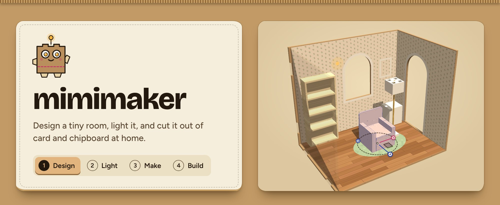
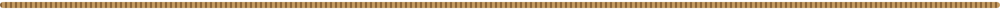
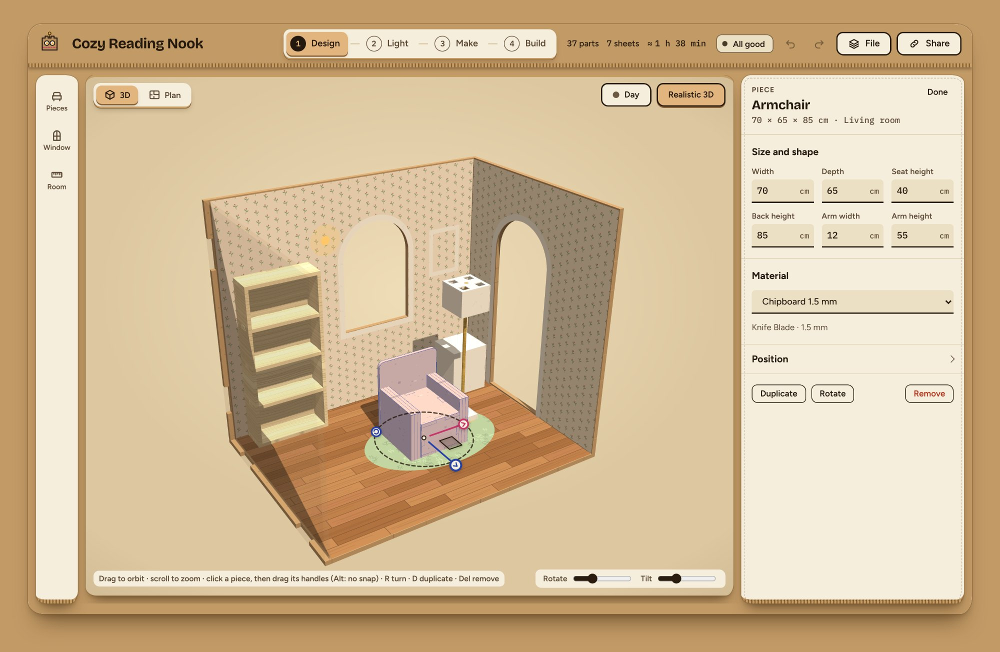
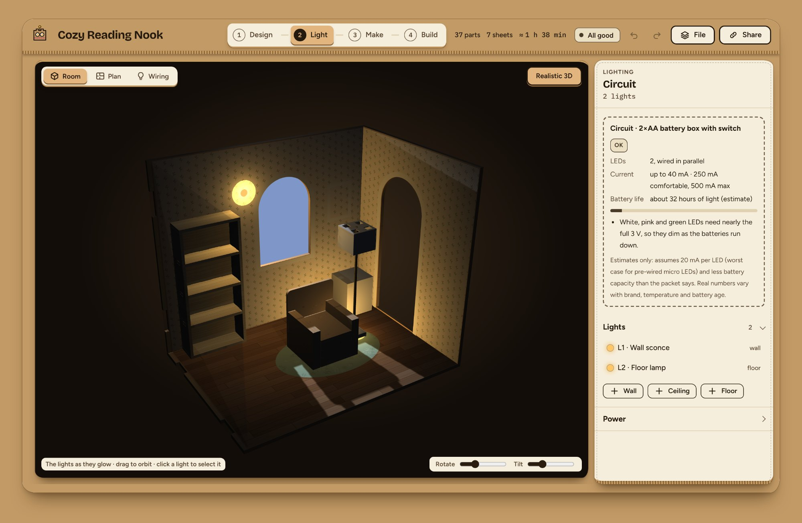
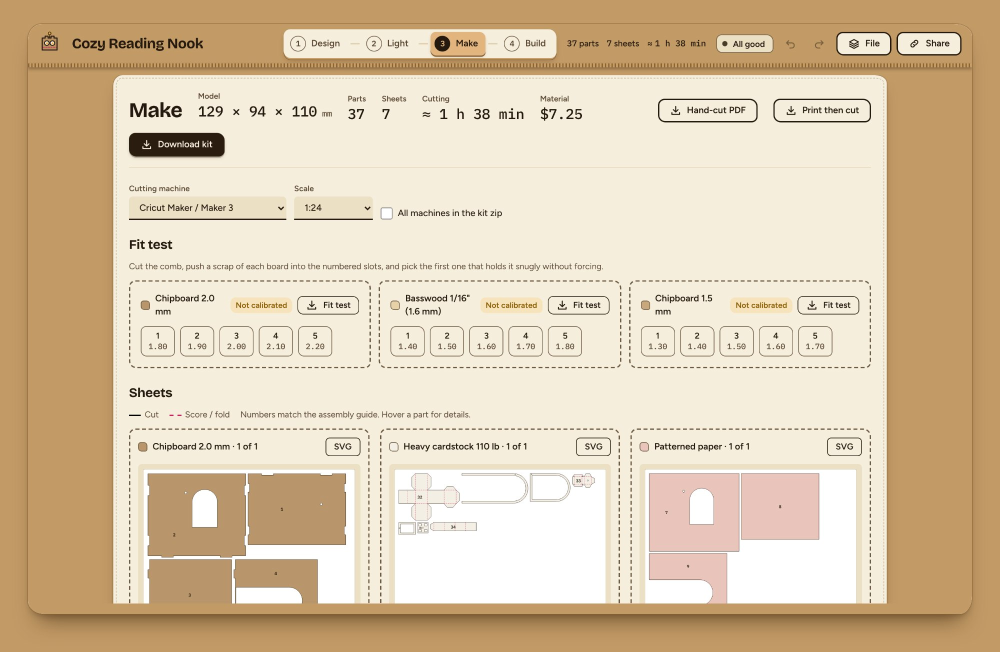
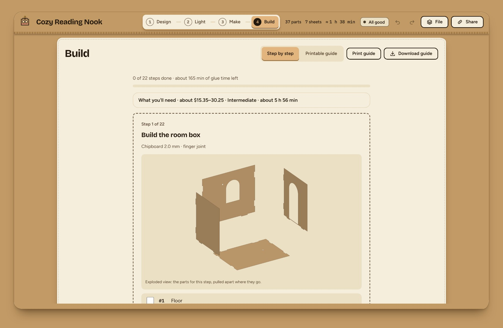
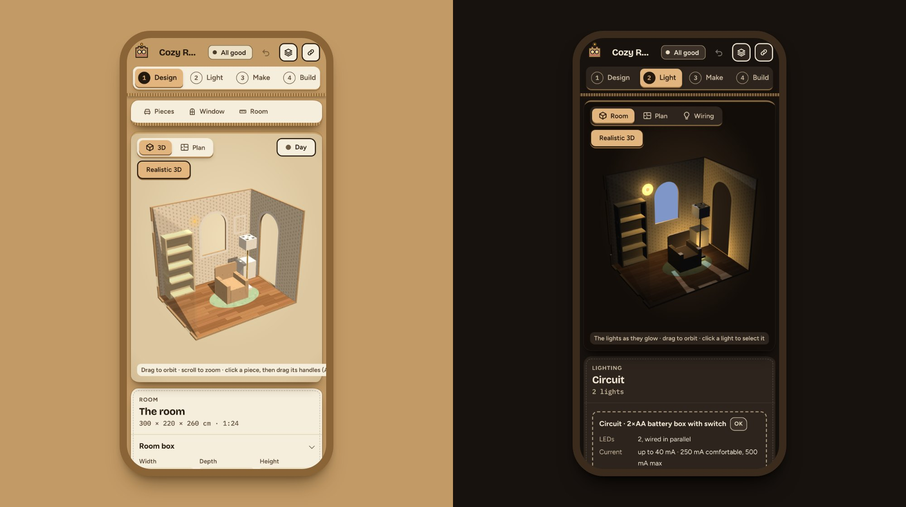
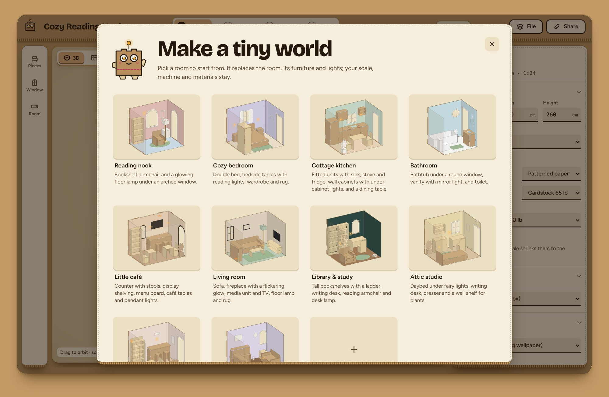
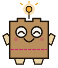

<!--
  The pictures in this README are made by docs/readme/make-art.cjs
  (`npm start`, then `npm run readme:art`). Each themed picture comes in a
  -light and a -dark version and GitHub shows the one that matches the
  reader's theme. The mascot is Mimi, from docs/design-system/assets/Mimi/;
  to swap it, replace those SVGs (or MASCOT in make-art.cjs) and rerun.
-->

<picture>
  <source media="(prefers-color-scheme: dark)" srcset="docs/readme/banner-dark.jpg">
  
</picture>

<p align="center">
  <b><a href="https://fjarnskaggl.github.io/mimimaker/">Open mimimaker</a></b>
  &nbsp;·&nbsp; <a href="#the-four-steps">The four steps</a>
  &nbsp;·&nbsp; <a href="#whats-in-the-box">What's in the box</a>
  &nbsp;·&nbsp; <a href="#quick-start">Quick start</a>
  &nbsp;·&nbsp; <a href="#contributing">Contributing</a>
</p>

mimimaker is a workbench for miniature room kits and book nooks. You pick a
room, drag the furniture where you want it and place the lights. mimimaker
then draws every part, joins the parts so they fit, numbers them and packs
them onto sheets for your cutting machine. You get cut files, a parts list,
a wiring plan and a step-by-step build guide in one `.zip`.

It's free and it runs in your browser. There are no accounts, no servers and
no paid parts: the whole app is a static page.

<picture>
  <source media="(prefers-color-scheme: dark)" srcset="docs/readme/divider-dark.png">
  
</picture>

## The four steps

Your room stays on the bench the whole way through. The steps along the top
are **Design**, **Light**, **Make** and **Build**, and you can go back to any
of them at any time.

### 1 · Design

<picture>
  <source media="(prefers-color-scheme: dark)" srcset="docs/readme/design-dark.jpg">
  
</picture>

Start from a room type, or from a blank box. Click a piece and drag its
handles: arrows and a square to move it, a ring to turn it in quarter turns.
Wall pieces slide along and up their wall. Moves snap to the grid, the walls,
the openings and the other pieces, guides show what lined up, and holding Alt
moves freely. The inspector on the right sizes the piece you picked; with
nothing picked, it sizes the room. **Plan** shows the same room from above,
and **Realistic 3D** adds textures and soft shadows.

### 2 · Light

<picture>
  <source media="(prefers-color-scheme: dark)" srcset="docs/readme/light-dark.jpg">
  
</picture>

Add lights to the walls, ceiling or floor (micro LEDs, candle flicker, fairy
lights or LED strip) and click one to move or change it. The room goes dark so
you can see them glow. The circuit card checks the current against your battery box and
estimates battery life. mimimaker cuts the wire holes, routes the wires
around the outside of the box, and can add a hidden base for the battery box
and a cable cover on the back. **Wiring** shows the room unfolded from
behind, the side you wire on.

### 3 · Make

<picture>
  <source media="(prefers-color-scheme: dark)" srcset="docs/readme/make-dark.jpg">
  
</picture>

Pick your cutting machine and scale, and see the parts, sheets, cutting time
and material cost. Cut the small **fit test** comb first, push a scrap of
your board into its slots and pick the snug one: every joint resizes to the
board you really have. Then download the kit, a hand-cut PDF to cut with a
craft knife, or print-then-cut sheets for wallpaper and floors.

### 4 · Build

<picture>
  <source media="(prefers-color-scheme: dark)" srcset="docs/readme/build-dark.jpg">
  
</picture>

Build walks you through one step at a time, with an exploded view of the
parts, a checklist to tick off and glue timers. Your progress is saved in
your browser. Prefer paper? Switch to **Printable guide**.

### On your phone

<picture>
  
</picture>

Every step works on a phone, so you can design on the sofa and build at the
table. mimimaker follows your device's light or dark setting.

<picture>
  <source media="(prefers-color-scheme: dark)" srcset="docs/readme/divider-dark.png">
  
</picture>

## What's in the box

### Rooms and book nooks

<picture>
  <source media="(prefers-color-scheme: dark)" srcset="docs/readme/start-dark.jpg">
  
</picture>

- **10 room types**, each with its own furniture, openings, lights and
  colours: reading nook, cozy bedroom, cottage kitchen, bathroom, little café,
  living room, library & study, attic studio, corner bakery and music room.
- **Book nook shells** sized to slide into a real shelf gap: open book nook,
  alley with lit facades, bookshop corner, staircase to a landing, greenhouse
  and a two-storey house.
- **The room box** can have a ceiling or a gable roof; rectangular, arched
  and round windows; doors and arched doors with trim; and wallpaper and
  floors cut to match the openings.
- Sizes are entered in real-world centimetres and scaled from 1:6 to 1:87.

### Pieces

More than 60 parametric pieces, so they resize to your room. Each one has
been checked to stand up from its own cut parts (see the
[buildability audit](docs/audits/buildability.md)).

| Theme | Pieces |
| --- | --- |
| Basics | bookshelf, cabinet/dresser, table, chair, bench/coffee table, desk |
| Living room | sofa, loveseat, corner sofa, armchair, fireplace, fire screen, media unit, sideboard, lamp table, floor lamp, upright piano |
| Bedroom | bed, bunk bed, crib, nightstand, chest of drawers, dressing table, wardrobe |
| Kitchen | base cabinet, sink unit, stove, fridge, wall cabinet, open wall shelf, kitchen island |
| Bathroom | bathtub, vanity, toilet, mirror cabinet |
| Café | shop counter, bar counter, bar stool, café table, display shelving, shop shelving, menu board |
| Library | library ladder, book stack, window seat, step cupboard, filing cabinet |
| Decor | rug, curtains, picture frame, round mirror/clock, wall clock, wall TV, coat stand, potted plant, potted tree, garden planter |
| Accessories | row of books, bakery treats, hanging sign, poster, little plant |

### Materials and machines

| Material | Examples | How parts are built |
| --- | --- | --- |
| **Board** | chipboard 1.5/2 mm, basswood 0.8/1.6 mm | Panels joined with a few stability tabs sized to the board, and tab-and-slot shelves. |
| **Card** | cardstock, patterned paper, clear acetate | Fold-up nets with score lines and glue tabs. Nets too big for the mat are split into tabbed panels. |
| **Fabric** | felt | Flat pieces such as rugs. |

The material library on the Make step lets you edit, add and price your own
materials. The machines are the Cricut Maker, Explore, Joy and Joy Xtra, the
Silhouette Cameo and Portrait, and a generic laser cutter (kerf-compensated
SVG and DXF). A kit can carry every machine's files at once, and any kit can
be printed as hand-cut templates on A4 or US Letter.

### And also

- **Checks.** The pill in the header says *All good*, or lists anything that
  would stop the build: overlaps, parts too big for the mat, joints too thin
  for your blade.
- **Undo and redo** for every change (Ctrl/⌘ Z, Ctrl/⌘ Shift Z). Keyboard
  shortcuts: R turns, D duplicates, Delete removes, and the arrow keys nudge
  (with Shift for 10 cm).
- **True-shape nesting** packs parts by their outlines, so small parts drop
  into window cut-outs.
- **Cut-time estimates** and the matching machine setting for every sheet.
- **Share links** put the whole design in the link, so anyone can open their
  own copy, with no account and no server.

<picture>
  <source media="(prefers-color-scheme: dark)" srcset="docs/readme/divider-dark.png">
  
</picture>

## Using the cut files


Each sheet is an SVG in millimetres with a colour for each operation:

- **black**: cut
- **magenta**: score (fold lines and glue-tab folds)
- **blue**: pen (part numbers, if "Draw part numbers" is on)

In Cricut Design Space, upload the SVG, insert it at its original size,
ungroup, set each colour's operation, then select everything and **Attach**
so the score and pen lines stay on their parts. The assembly guide in the zip
repeats these steps. Silhouette and laser kits get their own files (DXF as
well as SVG) and a `README.txt` in the zip on how to use them.

## Quick start

There's no build step and nothing to install. It's plain ES modules, and
Node 18+ is only needed for the dev server and the tests.

| Command | What it does |
| --- | --- |
| `npm start` | Serves the app at <http://localhost:5173>. Any static server works; `file://` doesn't, because browsers block module imports there. |
| `npm test` | Unit tests (Node's built-in test runner). |
| `npm run test:e2e` | Browser tests with Playwright and Chromium, including the user-journey flows. |
| `npm run build` | Writes `dist/mimimaker.html`, a single self-contained page that opens from `file://` or any host. |
| `npm run readme:art` | Retakes this README's screenshots and pictures (with `npm start` running). |

### Deploying to GitHub Pages

`.github/workflows/pages.yml` runs the tests and publishes the site on every
push to `main` (or by hand from the Actions tab with *Run workflow*). One-time
setup: **Settings → Pages → Build and deployment → Source: GitHub Actions**.

The app is then at `https://<user>.github.io/mimimaker/`, published as one
bundled page so browsers never mix old and new files. The single-file build
is at `…/mimimaker/mimimaker.html`.

## How the joinery works

`src/box.js` draws each panel at its full outer size. Along every shared edge
the board-thick strip is split into an odd number of segments, with a few
tabs placed for stability (never narrower than the cutter can cut cleanly),
and the panel with the higher rank (floor/ceiling > front/back > sides) keeps
the end segments. Because the ranking is a strict order, each corner cube
ends up in exactly one panel. The tests check this: for every combination of
faces, the panel areas × thickness equal the exact volume of the walls.

`src/fold.js` unfolds the faces of a box along a spanning tree from a base
face. Tree edges become score lines, and every other shared edge gets a
trapezoid glue tab on the face that folds last.

## Project layout

```
index.html, styles.css   UI shell
src/app.js               UI controller (state, forms, downloads)
src/kit.js               compiles a kit → parts, 3D faces, steps, sheets, warnings
src/catalog.js           themed furniture and decor pieces
src/templates.js         room types (starter layouts)
src/box.js               jointed boxes and shelves
src/fold.js              fold-up nets and glue tabs
src/geometry.js          polygons, edge profiles, arches, joint segments
src/nest.js              shelf packing onto sheets
src/svg.js               Design Space SVGs and sheet previews
src/labels.js            part-number placement and a pen-friendly digit font
src/preview3d.js         sketch 3D preview (SVG)
src/guide.js             printable assembly guide
src/materials.js         materials and machines
src/make.js              cut-time estimates and machine settings
src/share.js             share links
src/pieces/              piece definitions by theme (see its README)
src/shells/              book nook shells
src/export/              machine files, hand-cut and print-then-cut PDFs, nesting, cost
src/build/               build mode: steps, joints, exploded views, parts list
src/lighting/            LED effects, circuits, hidden base, cable cover, shopping list
src/render/              Realistic 3D viewer (three.js)
src/textures/            procedural textures (wood, tiles, brick, wallpaper)
src/ui/                  panels, handles, checks and design-system art
docs/design-system/      tokens, components and Mimi
docs/readme/             this README's pictures and the script that makes them
docs/threads/            how the workstreams are organised
```

## Contributing



Work is split into parallel workstreams; the rules are in
[docs/threads/README.md](docs/threads/README.md) and the roadmap is tracked in
[#1](https://github.com/Fjarnskaggl/mimimaker/issues/1). In short: write a
failing test first (CI checks this with `npm run check:test-first`), keep PRs
small, and use original designs only. New screens follow the
[design system](docs/design-system/README.md): the Card and chipboard theme
by day and Cardboard at night after dark.

## Known limitations


- **Measure your board.** Joints assume the thickness in the materials
  table until you run the fit test. Cutting-machine files have no kerf
  compensation (the Knife Blade's kerf is tiny); laser files do.
- **Design Space re-lays out parts** unless you Attach them after uploading.
- **Realistic 3D needs WebGL** and loads three.js from a CDN. Without it,
  mimimaker falls back to the sketch 3D view.
