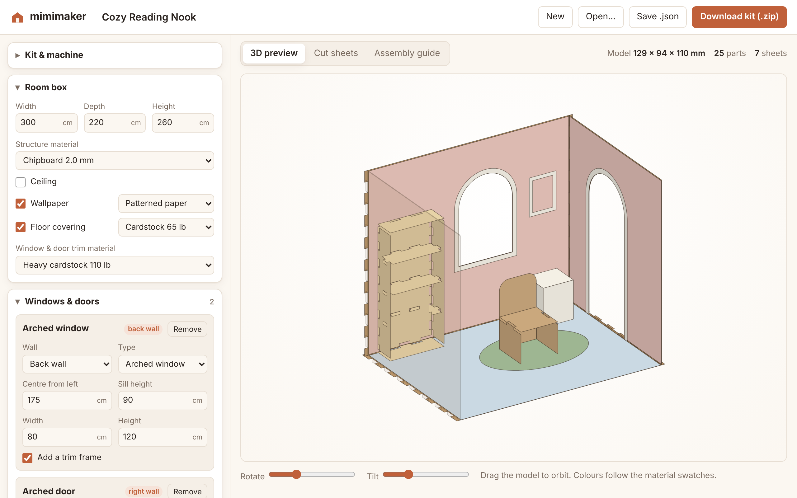

# mimimaker

Design miniature room kits — think DIY book nooks and room boxes — and export
Cricut-ready cut files, a parts list and an assembly guide.

You describe the room (size, scale, windows and doors, wallpaper) and drop in
furniture from a parametric catalogue. mimimaker generates every part, joins
them so they fit together, numbers them, packs them onto mats for your machine
and material, and bundles it all into a `.zip`.



## Running it

No build step and no dependencies — it's plain ES modules.

```bash
npm start
```

then open <http://localhost:5173>. (Any static file server works; it just
can't be opened straight from `file://` because browsers block module imports
there.)

```bash
npm test
```

runs the geometry and kit tests with Node's built-in test runner (Node 18+).

## What it makes

| Material kind | Examples | How boxes are built |
| --- | --- | --- |
| **Board** | chipboard 1.5/2 mm, basswood 0.8/1.6 mm | Finger-jointed panels sized to the material thickness; shelves use tab-and-slot joints. Needs the Knife Blade (Cricut Maker). |
| **Card** | cardstock, patterned paper | Fold-up nets with score lines and glue tabs. If a net won't fit the mat it's split into separate tabbed panels. Works on any Cricut. |
| **Fabric** | felt | Flat pieces only (rugs). Rotary Blade. |

Catalogue: room box (optional ceiling), rectangular / arched / round windows,
doors and arched doors (with optional trim frames and window muntins),
wallpaper and floor overlays that match the openings, bookshelf, cabinet /
dresser, nightstand, wardrobe, table, desk, bench, bed, chair, rug, picture
frame and round mirror.

All sizes are entered in real-world centimetres and scaled (1:6 to 1:87).

## Using the cut files in Cricut Design Space

Each sheet is an SVG in millimetres with colour-coded layers:

- **black** — Cut
- **magenta** — Score (fold lines and glue-tab folds)
- **blue** — Pen (part numbers, if "Draw part numbers" is on)

Upload the SVG, insert it at its original size, ungroup, set each colour's
operation, then select everything and **Attach** so score/pen lines stay on
their parts. The generated assembly guide repeats these steps.

## How the joinery works

`src/box.js` draws each panel at its full outer size. Along every shared edge
the material-thick strip is split into an odd number of fingers; the panel with
the higher rank (floor/ceiling > front/back > sides) keeps the end fingers.
Because the ranking is a strict order, each corner cube ends up in exactly one
panel. The tests check this: for every combination of faces, the panel areas ×
thickness equal the exact volume of the assembled walls.

`src/fold.js` unfolds the faces of a box along a spanning tree from a base
face. Tree edges become score lines and every other shared edge gets a
trapezoid glue tab on the face that folds last.

## Project layout

```
index.html, styles.css   UI shell
src/app.js               UI controller (state, forms, downloads)
src/kit.js               compiles a kit → parts, 3D faces, steps, sheets, warnings
src/catalog.js           furniture/decor templates and the sample kit
src/box.js               finger-jointed boxes and shelves
src/fold.js              fold-up nets and glue tabs
src/geometry.js          polygons, edge profiles, arches, segment chaining
src/nest.js              shelf packing onto sheets
src/svg.js               Design Space SVGs and sheet previews
src/labels.js            part-number placement and a pen-friendly digit font
src/preview3d.js         SVG 3D preview
src/guide.js             printable assembly guide
src/zip.js               tiny zip writer for the kit download
```

## Known limitations / next steps

- Measure your board: finger joints assume the thickness in the Materials
  table. There's no kerf compensation yet (the Knife Blade's is tiny).
- Nesting is rectangle-based (shelf packing), so oddly shaped parts waste some
  space. Design Space will also re-lay-out parts unless you Attach them.
- No print-then-cut yet. Wallpaper and floors are cut from pre-printed paper
  rather than printed with patterns.
- Ideas: a more detailed furniture catalogue (sofas, kitchen units, stairs),
  book nook shells with a slanted roof, LED channels, and custom part shapes
  from uploaded SVGs.
